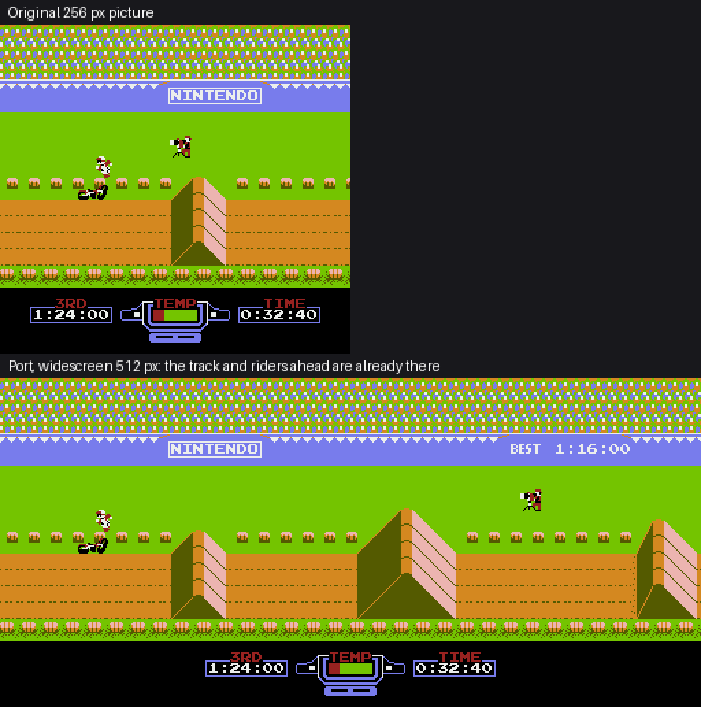
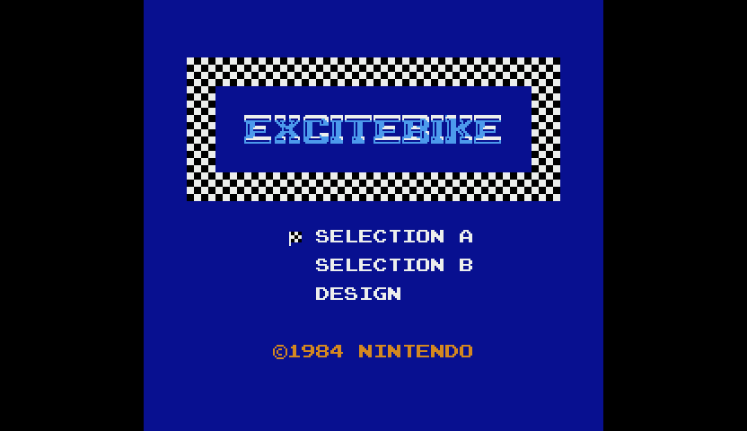
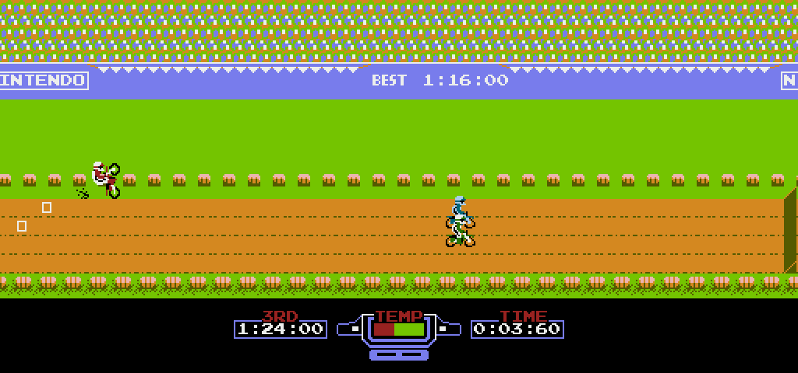
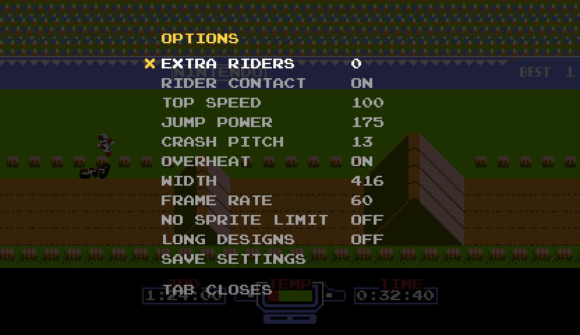
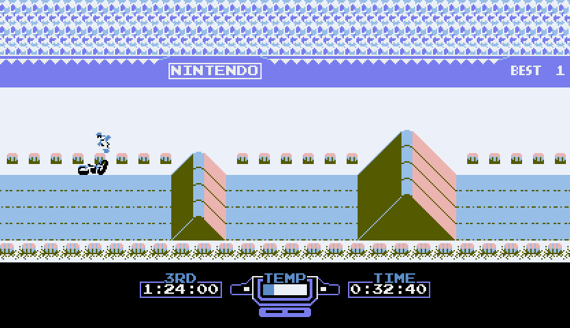
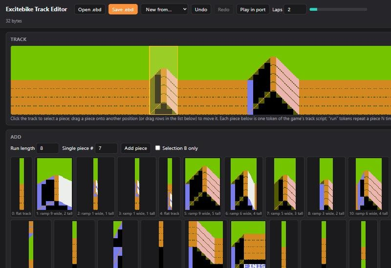
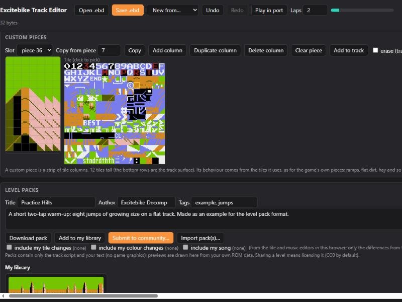
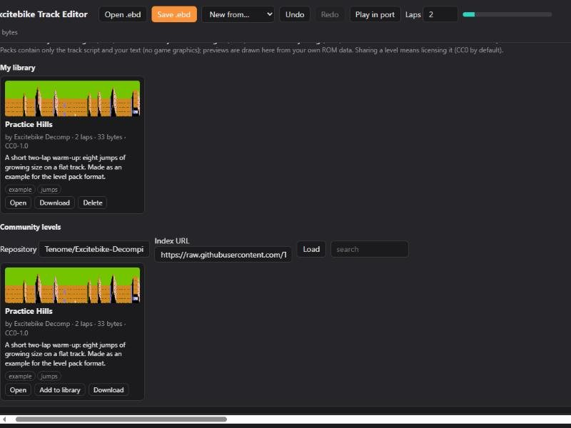
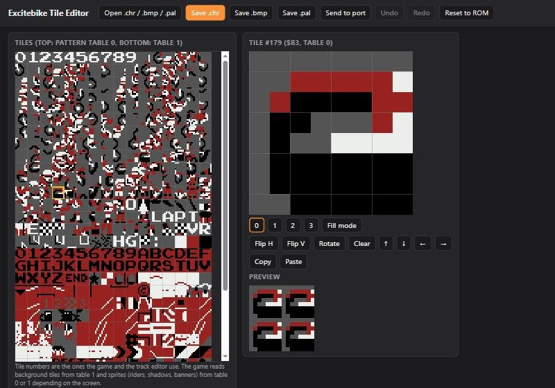
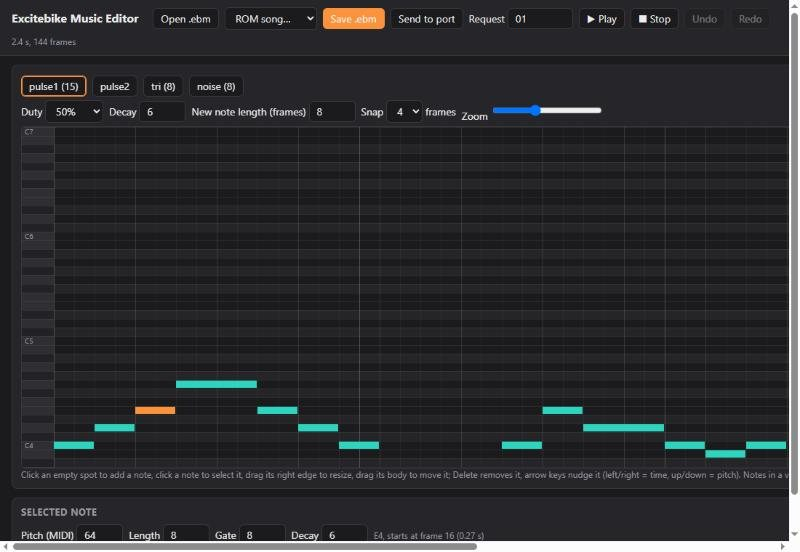

# Excitebike: matching decompilation and native PC port

[](https://bytematch.dev/Tenome/Excitebike-Decompilation)

A **matching decompilation** of *Excitebike* (Nintendo, 1984/1985) for the Famicom/NES, and a **native PC port** built from it. The assembly source rebuilds each ROM **byte for byte**; all game logic is lifted to C and
differential-tested against the original 6502 code; the port runs that C directly (no CPU emulation) with widescreen, extra CPU riders, higher frame rates, an options menu, mod loading and a set of browser editors for tracks, graphics and music.



This repository contains **no game files**; you need your own ROM. *Excitebike* is a trademark of Nintendo; this is an unofficial fan project, and the screenshots show the port running the author's own ROM.

| Version | ROM | Notes |
|---|---|---|
| `us` | Excitebike (Japan, USA) (En), NTSC | NROM-128: 16 KB PRG at `$C000`, 8 KB CHR, vertical mirroring |
| `eu` | Excitebike (Europe), PAL | same code; 17 timing-table bytes differ, header byte 12 = PAL |

## The PC port

`excitebike.exe` starts like a normal program: it opens on the title menu, in widescreen, with no ROM file needed (see [Getting it](#getting-it)). Arrows, **Z** accelerate, **X** turbo, **Enter** Start, **Shift** Select, **Tab** options, F5/F9 quick save/load, F6 reload mods, F11 fullscreen.

### Widescreen without pop-in

The picture is 416 pixels wide by default and goes up to 512 (the track ring buffer holds exactly 512 pixels). The port keeps the track, CPU riders and scrolling objects ahead of the visible edge, so nothing appears out of thin air mid-screen.
At width 256 the game is exactly the original. Menus stay centred.



### Extra CPU riders and rider contact

Up to four extra CPU riders run the game's own physics, ramps, crashes and AI, enter from beyond the wide edge, and collide with the real riders (switch it off in the menu). They never change the game's own state.



### Options menu, rules and frame rate

**Tab** pauses the game and opens a menu drawn with the game's own font: extra riders, rider contact, top speed, jump power, crash pitch, overheating, picture width, frame rate (60 / 120 / 180 / 240 with object-based interpolation: riders move by how far the game moved them, whatever sprite slot or animation frame they use),
the sprite limit and long designs. SAVE SETTINGS writes `excitebike.cfg`.



### Mods and live reload

A tile or colour change, a sound or a whole level is a file the port loads at start and reloads on **F6** (or automatically with `--watch`):

* graphics: `--chr-bmp tiles.bmp`, `--palette colors.pal` (made with the tile editor);
* audio: WAV files, custom `.ebm` songs played through the APU, and an engine tone (`--audio-mod`, or a `mods/audio` folder next to the program);
* tracks: `--track N=level.ebd` or a `.ebpack.json` level pack, which can also carry tile, colour and song changes and custom track pieces;
* the in-game design editor can record tracks longer than the original 236 bytes (`--long-designs`).



Everything is documented in [port/README.md](port/README.md).

## Editors

Three browser editors (plain HTML, no install; they read your own ROM) write the files the port loads. Open them with `excitebike-editors.exe` or `python tools/editor/serve.py excitebike.nes`.
**Play in port** and **Send to port** start the port in a race on track 1 and update it live while you edit.

**Track editor.** The track as the game draws it; add, delete, reorder (drag), repeat and edit pieces, laps and Selection-B-only pieces, start from any built-in track, save `.ebd` files or level packs.



**Custom pieces and level packs.** Design new track pieces (numbers 36-47) from the game's tiles, and package a level with its title, author, description and tags, optionally with your tile, colour and song changes.



**Community levels.** A local library with previews drawn from your own ROM, a browser for the repository's `levels/` folder, and **Submit to community**, which opens GitHub's web editor so a level becomes a pull request (nothing is sent without your confirmation). See [levels/README.md](levels/README.md).



**Tile and palette editor.** All 512 tiles with flip/rotate/shift/fill, game and custom colour sets, master-palette editing; saves `.chr`, `.bmp` and `.pal`.



**Music editor.** A piano roll for the four voices (two pulses, triangle, noise) with a rough in-browser preview; edits the ROM's own songs or new ones as `.ebm` text.



## Getting it

**A private build that needs no ROM file** (for your own use; it contains game data, so never share it):

```
python tools/build_exe.py --sdl-dir <SDL2 devel folder>     # reads orig/excitebike_us.nes (and _eu.nes), builds dist/Excitebike/
```

`dist/Excitebike/excitebike.exe` runs from any folder; `--region eu` (or `region=eu` in `excitebike.cfg`) selects the PAL version if both ROMs were embedded. `excitebike-editors.exe` opens the editors (Python 3 needed).

**A build that reads a ROM file** (what the repository's CI builds):

```
clang -O2 -o excitebike port/main.c port/ppu.c port/apu.c port/audiomod.c c/excitebike.c -I<SDL2>/include -L<SDL2>/lib/x64 -lSDL2     # or make (Linux/macOS), or port/CMakeLists.txt
excitebike excitebike.nes
```

A quick tour: [docs/GETTING_STARTED.md](docs/GETTING_STARTED.md).

## Decompilation status

| | |
|---|---|
| Code found | 11,349 bytes in 215 routines per version (2,797 opcodes seen executing; the rest reached statically); the other 13,227 bytes are data: tables, track pieces, text, graphics |
| Byte identity | `python tools/build.py --version us|eu` prints `MATCH` |
| Lifted to C | all game logic and hardware access (hand-lifted routines in `c/excitebike.c`; the data-recorder code mechanically via `tools/lift6502.py`; the sound engine is hand-written readable C in `c/sound.inc`). Every routine has a differential test against the original 6502 code (`tools/difftest.py`: RAM, result registers and the ordered hardware writes on random states) and the whole C game runs frame-identical to the ROM from reset on both versions (`tools/fulltest.py`) |
| Native build (static recompilation) | `recomp/build_native.ps1` statically recompiles the classified code to C with [NESRecomp](https://github.com/mstan/nesrecomp); over 120,000 random-input frames it matched the interpreter hash for hash |
| Not done yet | a game-state renderer that draws from game state instead of PPU writes, a verified Linux build, and turning the RAM image into separate rider structures (see [docs/ROADMAP.md](docs/ROADMAP.md), [docs/PORT_FEATURES.md](docs/PORT_FEATURES.md)) |

Progress is published to [ByteMatch](https://bytematch.dev/Tenome/Excitebike-Decompilation) as two kinds of report per version (`progress/<ver>/report.json`, `progress/<ver>_c/report.json`). The first counts **byte-exact assembly source** (instructions and `.incbin` data both count as matching, so it starts at 100 %).
The `_c` reports count a routine as matched when its lifted C passes the differential test against the 6502 code (`config/<ver>/verified.json`, written by `python tools/difftest.py --json`); both are at 100 % now. [docs/PROGRESS.md](docs/PROGRESS.md) explains how the reports are made and what each percentage means.
What continues from here is understanding: names, structured data, readable C.

## Building the disassembly

```
# put your ROMs in orig/ (see orig/README.md); install cc65 (ca65 + ld65) and Python 3.10+
python tools/ebdis.py --version us     # extract assets/us/ from your ROM and (re)generate src/us/
python tools/build.py --version us     # ca65 + ld65, compares with orig/excitebike_us.nes; prints MATCH
python tools/report.py --version us    # verify, then write progress/us/report.json
python tools/report.py --version us --c   # C lifting report: progress/us_c/report.json (needs config/us/verified.json from tools/difftest.py --json)
# same with --version eu
```
cc65 is found through `--cc65 DIR`, `$CC65_DIR` or `PATH`. Edit `config/<ver>/*.json` (names, RAM names, hints), not the generated `src/`. Run the tests with `python tests/test_tools.py` (and the other `tests/test_*.py`).

## Layout

| Path | Contents |
|---|---|
| `src/<ver>/` | generated ca65, one file per module (`boot`, `game_states`, `tape`, `riders`, `rider_draw`, `track_scripts`, `design_mode`, `track_render`, `sound`, ...) plus `excitebike.asm` (header, includes) and `hardware.inc` (PPU/APU registers and RAM names) |
| `config/<ver>/` | `coverage.json` (opcodes executed in play), `names.json`, `ram.json`, `modules.json` (file split), `comments.json` (routine headers), `hints.json`, `verified.json` (routines that pass their test); `config/excitebike.cfg` is the ld65 layout |
| `assets/<ver>/` | data extracted from your ROM (git-ignored) |
| `c/` | the lifted C game: `excitebike.c` (hand-lifted logic and hardware access), `sound.inc` (the sound engine), `extra_riders.inc` (extra CPU riders), `tape_recorder.inc` (mechanical lift), `ram_names.h` (named game state), `excitebike.h` |
| `port/` | native PC runtime: `main.c` (SDL2 front end, options menu, mod loading), `ppu.c` (scanline picture layer), `apu.c`, `audiomod.c` (WAV and `.ebm` playback), `editors.c` (editors launcher), see [port/README.md](port/README.md) |
| `tools/` | `ebdis.py` tracing disassembler/emitter, `build.py`, `build_exe.py`, `package.py`, `report.py`, `sim6502.py` + `difftest.py` + `fulltest.py` (lift verification), `lift6502.py` (mechanical 6502 to C lifter), `ebdesign.py`, `ebmusic.py`, `levelpack.py`, `chrbmp.py` (track, music, level pack and graphics formats), coverage tools |
| `tools/editor/` | the browser editors (`index.html` tracks and level packs, `tiles.html`, `music.html`) and `serve.py` |
| `levels/` | community level packs (`*.ebpack.json`) and the generated `index.json`; see [levels/README.md](levels/README.md) |
| `tests/` | tests for the tools, the editor server, long designs, interpolation and the editors' scripts |
| `progress/<ver>/`, `progress/<ver>_c/` | objdiff-format reports for ByteMatch (published by `.github/workflows/report.yml`) |
| `recomp/` | native Windows build script |
| `docs/` | [GETTING_STARTED.md](docs/GETTING_STARTED.md), [NOTES.md](docs/NOTES.md) findings, [PROGRESS.md](docs/PROGRESS.md), [ROADMAP.md](docs/ROADMAP.md), [PORT_FEATURES.md](docs/PORT_FEATURES.md), `images/` (the screenshots above) |
